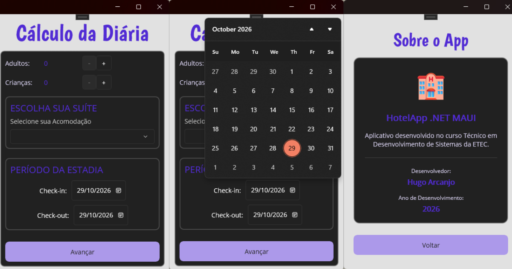

# 🏨 App Hotel em .NET MAUI

Aplicativo de **Cálculo de Diárias e Hospedagem** desenvolvido para a disciplina do curso técnico em Desenvolvimento de Sistemas da **Etec**. O projeto utiliza **C#** e **XAML** com a plataforma **.NET MAUI**, explorando conceitos de *Data Binding*, componentes gráficos modernos e controle de janelas.

---

## 📸 Demonstração da Aplicação

---

## 🚀 Funcionalidades

- **Cálculo Dinâmico**: Seleção de quantidade de adultos e crianças utilizando o componente `Stepper`.
- **Escolha de Acomodações**: Definição do tipo de suíte através de um menu suspenso (`Picker`).
- **Período de Estadia**: Definição interativa de datas de *Check-in* e *Check-out* usando o `DatePicker`.
- **Tela "Sobre"**: Seção dedicada com informações educacionais, dados do desenvolvedor e ano de desenvolvimento.
- **Layout Personalizado**: Design estilizado em formato mobile (proporção de janela configurada) com paleta de cores no estilo *Dark Mode*.

---

## 🛠️ Tecnologias Utilizadas

- **.NET MAUI** (Multi-platform App UI)
- **C#** (Lógica de navegação e regras de negócio)
- **XAML** (Interface gráfica, *Data Binding* e estilos)
- **Visual Studio** (IDE de desenvolvimento)

---

## 📁 Estrutura do Código

- `App.xaml.cs`: Configuração da inicialização da janela do aplicativo com dimensões personalizadas (400x600).
- `Views/ContratacaoHospedagem.xaml`: Define os controles de formulário (`Stepper`, `Picker`, `DatePicker`) e o layout geral da tela de reserva.
- `Views/Sobre.xaml`: Tela informativa contendo os detalhes acadêmicos e créditos do desenvolvedor.

---

## 📄 Licença

Este projeto é um trabalho acadêmico desenvolvido para estudo no curso técnico da Etec.